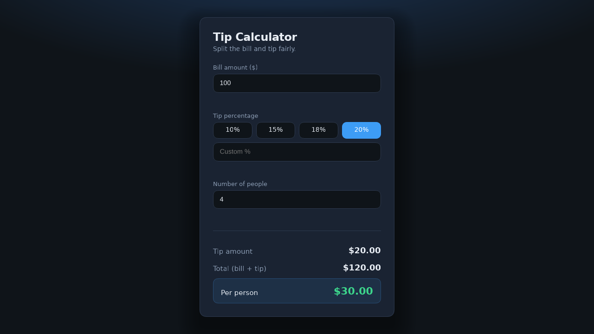

# Tip Calculator

A small, single-page tip calculator that helps you figure out how much to tip and how to split the check.

## Features

- **Bill amount** — Enter the pre-tip total in dollars.
- **Tip percentage** — Choose a preset (10%, 15%, 18%, or 20%) or type a custom percentage.
- **Split between people** — Divide the grand total evenly by headcount.
- **Live results** — Tip amount, bill + tip total, and per-person share update as you type.
- **Input validation** — Rejects invalid numbers, negative values, and non-integer party sizes (with short inline error messages).

## How to run

No build step or server is required.

1. Open `index.html` in any modern web browser (double-click the file, or use **File → Open** and select it).

That’s it. The page works fully offline.

## Files

| File        | Description                          |
| ----------- | ------------------------------------ |
| `index.html` | App UI (inline CSS + JavaScript)   |
| `README.md`  | This documentation                 |

## Screenshot

Built with Cursor (Composer 2.5) for MLH Global Hack Week: Hacktoberfest 2026, Challenge 1.
